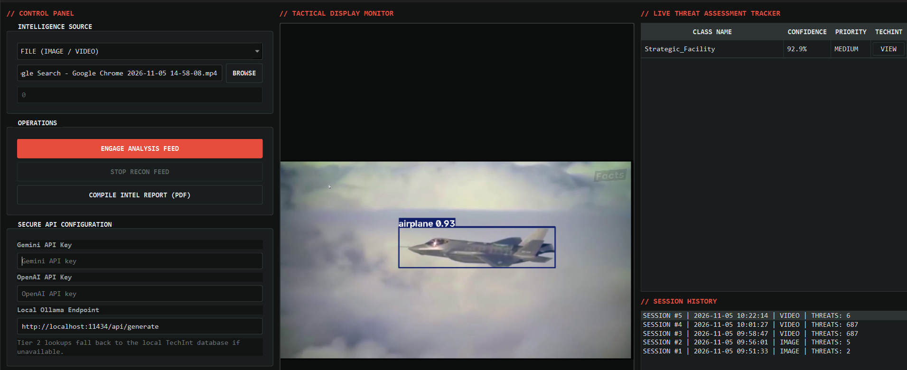
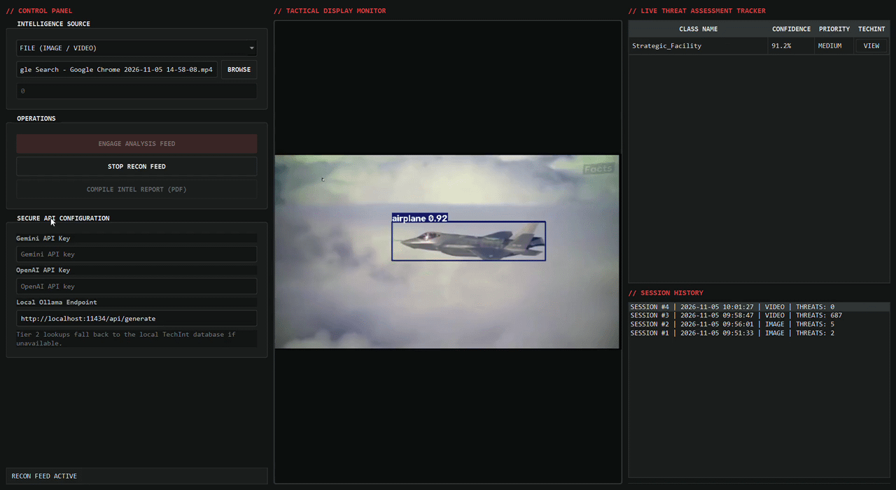
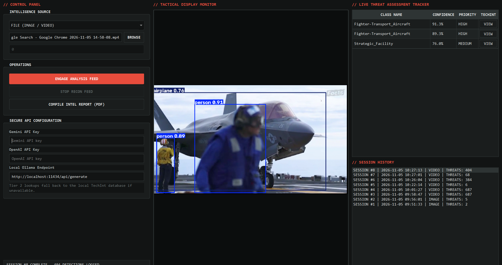
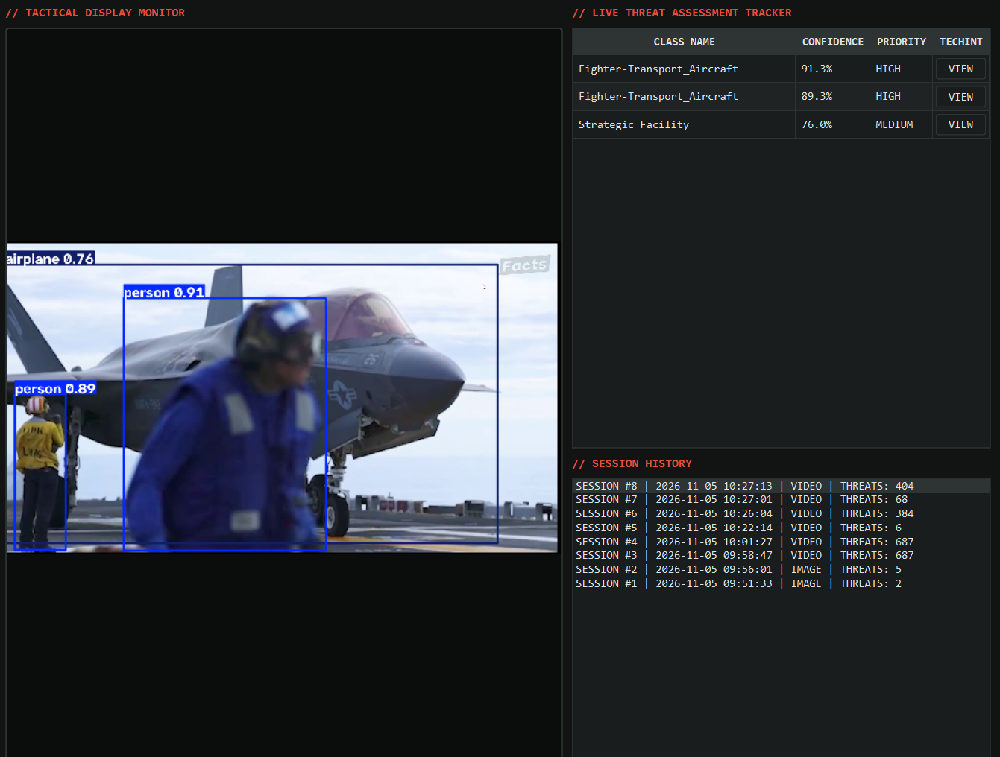
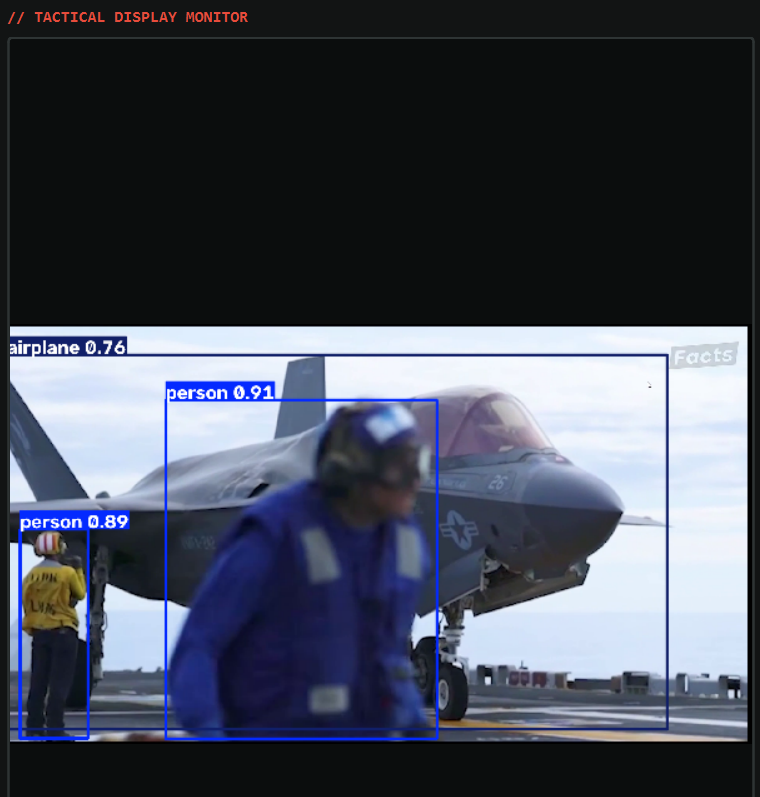
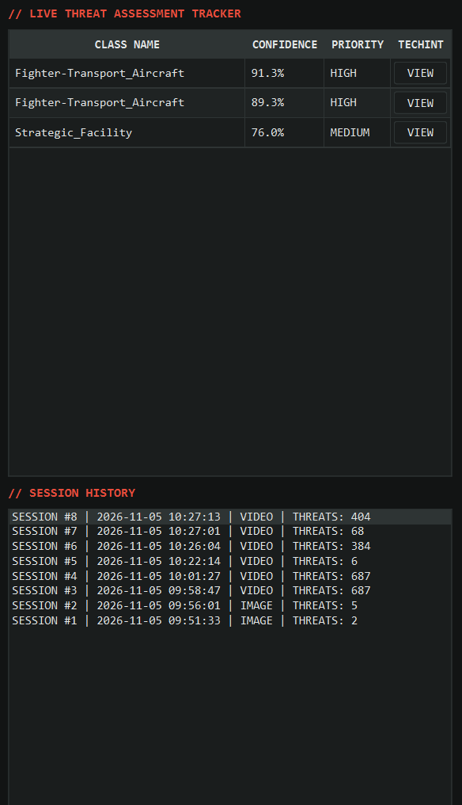
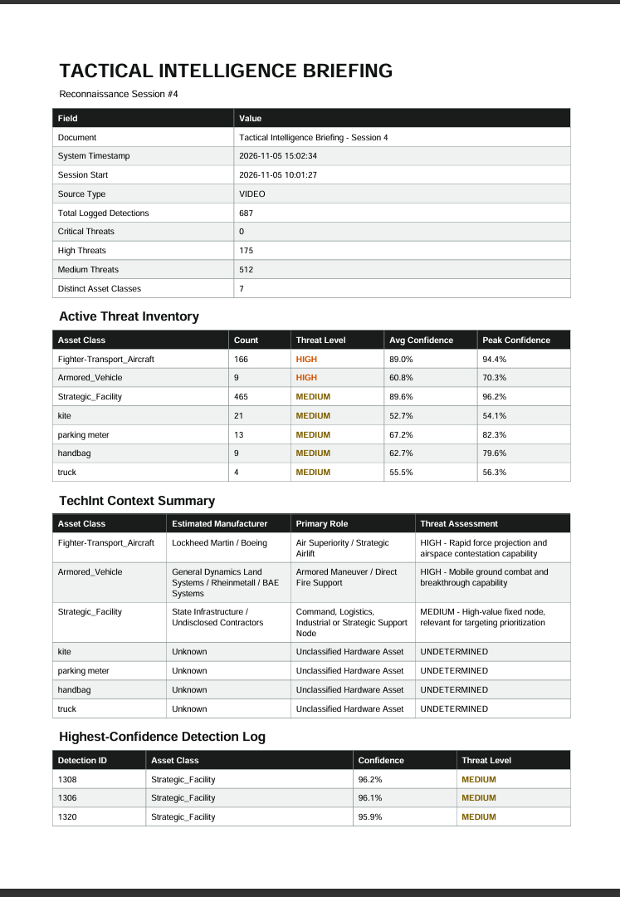
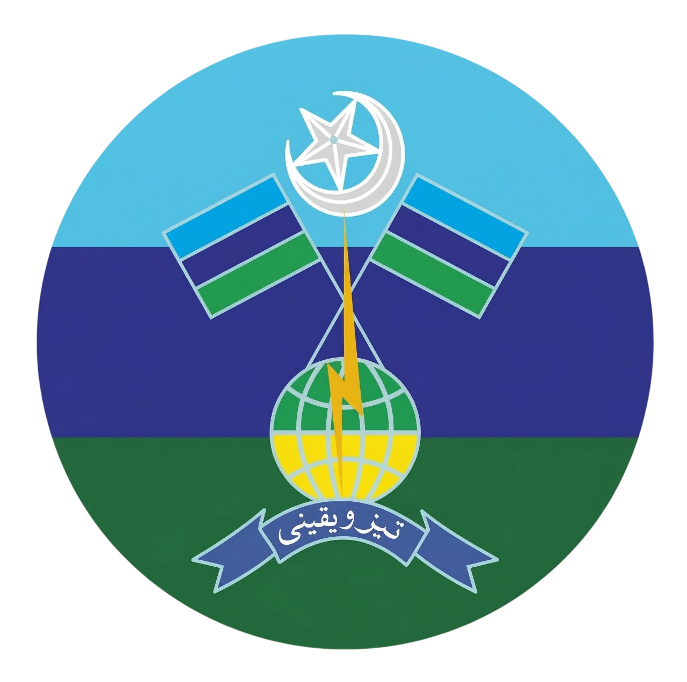

<!-- ============================================================================
     README MEDIA GUIDE
     Drop your media files into docs/assets/ using the exact filenames below.
     Every image/GIF block is marked with a [MEDIA] comment. Replace the file
     at the referenced path and the README will render it automatically.
============================================================================ -->

<div align="center">

<!-- [MEDIA] Wide banner / cover image of the dashboard.
     Recommended: 1600x500 PNG, dark tactical theme.
     File: docs/assets/banner.png -->


# TACTICAL SATELLITE IMAGERY & RECONNAISSANCE DASHBOARD

**AI-powered multi-source target detection, SQLite intelligence logging, and automated PDF briefing generation — built natively on PyQt6 + YOLOv8.**


<!-- [MEDIA] Short looping screen recording of a live analysis run.
     Recommended: 10–20 s GIF or MP4->GIF, 1280px wide, under 10 MB.
     File: docs/assets/demo.gif -->


</div>

---

## Overview

This system is a **native desktop tactical intelligence workstation** for automated analysis of satellite imagery, aerial photographs, recorded surveillance video, and live camera feeds. A custom-trained **YOLOv8 Small (22.5 MB)** model detects and classifies five military asset categories in real time; every detection is persisted to a local **SQLite** intelligence database, enriched through a **hybrid TechInt routing engine**, and compiled into **print-ready PDF intelligence briefings** on demand.

The interface runs a decoupled, multi-threaded ingestion core so the operator console stays fluid at high frame rates even while the inference engine saturates the CPU/GPU.

---

## Key Capabilities

| Domain | Capability |
|---|---|
| **Ingestion** | Still images (JPG/PNG/BMP/TIFF/WEBP), video files (MP4/AVI/MOV/MKV), live camera streams by device index |
| **Detection Core** | Ultralytics YOLOv8 running inside an isolated `QThread` worker, 0.50 default confidence gate |
| **Persistence** | Automatic SQLite schema validation at boot; batched detection writers; session-level rollups |
| **TechInt Engine** | Tier 1 seeded SQLite spec dictionary, Tier 2 optional Gemini / OpenAI / local Ollama enrichment with graceful fallback |
| **Reporting** | One-click ReportLab PDF briefing with metadata header, threat inventory, TechInt summary, and ranked detection log |
| **Interface** | Three-zone dark tactical console (control panel / vision monitor / live threat tracker) with per-row TechInt inspection |

---

## System Gallery

<!-- [MEDIA] Full dashboard with an active annotated feed.
     Recommended: 1440x900 screenshot, PNG.
     File: docs/assets/screenshot_dashboard.png -->


*Figure 1 — Main operator console: control panel (left), tactical display monitor (center), live threat tracker (right).*

<!-- [MEDIA] Close-up of the annotated detection output with bounding boxes.
     Recommended: 1280x720 PNG.
     File: docs/assets/screenshot_detection.png -->


*Figure 2 — YOLOv8 annotated frame rendered on the tactical display monitor.*

<!-- [MEDIA] The threat assessment table populated with live detections.
     Recommended: 600x700 PNG.
     File: docs/assets/screenshot_tracker.png -->


*Figure 3 — Real-time threat table: class, confidence, priority level, and per-row TechInt access.*

<!-- [MEDIA] TechInt context dialog for an inspected asset class.
     Recommended: 700x500 PNG.
     File: docs/assets/screenshot_techint.png -->


*Figure 4 — TechInt lookup: manufacturer, primary role, and threat assessment for an inspected target class.*

<!-- [MEDIA] First page of a generated tactical_briefing_session_X.pdf.
     Recommended: export page 1 of a real report as PNG.
     File: docs/assets/screenshot_report.png -->


*Figure 5 — Automated PDF briefing compiled from the active session's database records.*

---

## Architecture


```
┌─────────────┐    QImage signals     ┌──────────────────────────────┐
│  OpenCV /   │ ────────────────────► │  PyQt6 MainWindow (UI thread)│
│  YOLOv8     │    detection lists    │  • Display monitor           │
│  QThread    │ ────────────────────► │  • Threat tracker            │
└──────┬──────┘                       │  • Session history           │
       │ batched writes               └──────┬───────────────┬───────┘
       ▼                                      ▼               ▼
┌─────────────┐   seeded specs   ┌──────────────────┐  ┌───────────────┐
│   SQLite    │ ◄─────────────── │  TechInt Router  │  │  ReportLab    │
│ tactical_   │                  │  Tier1 DB →      │  │  PDF Engine   │
│ intel.db    │                  │  Tier2 LLM APIs  │  │               │
└─────────────┘                  └──────────────────┘  └───────────────┘
```

**Module map**

| Module | Responsibility |
|---|---|
| `main.py` | Bootstrap: sys.path guard, layout check, DB validation, app launch |
| `config/settings.py` | Palette, class schema, thresholds, API endpoints, TechInt seed data |
| `core/database.py` | `DatabaseManager` — DDL builders, session/detection writers, TechInt spec store |
| `core/engine.py` | `VideoProcessingThread` — decoupled capture + YOLO inference worker |
| `core/techint.py` | `TechIntRouter` + `TechIntThread` — Tier 1 SQLite → Tier 2 LLM fallback |
| `core/reporters.py` | `compile_intel_report()` — ReportLab platypus briefing compiler |
| `ui/main_window.py` | `MainWindow` — three-zone layout composition and session lifecycle |
| `ui/components.py` | Styled widgets (PanelTitle, TacticalButton, DisplayCanvas, ...) + QSS loader |
| `ui/styles.qss` | Dark combat theme stylesheet overrides |

---

## Detection Schema & Threat Matrix

| Class ID | Asset Class | Threat Level |
|:---:|---|:---:|
| 0 | Fighter-Transport_Aircraft | HIGH |
| 1 | Naval_Combatant | HIGH |
| 2 | Armored_Vehicle | HIGH |
| 3 | Air_Defense_System | **CRITICAL** |
| 4 | Strategic_Facility | MEDIUM |

Default inference confidence threshold: **0.50** (change in `config/settings.py`).

---

## Project Structure

```
tactical_dashboard_project/
│
├── config/
│   ├── __init__.py
│   └── settings.py          # UI colors, configurations, and API endpoint urls
│
├── core/
│   ├── __init__.py
│   ├── database.py          # SQLite connection manager, DDL builders, log writers
│   ├── engine.py            # Decoupled QThread running OpenCV and the YOLO model worker
│   ├── reporters.py         # ReportLab PDF design layouts and compilation flows
│   └── techint.py           # Hybrid Spec-Router (SQLite dictionary + LLM APIs fallback)
│
├── ui/
│   ├── __init__.py
│   ├── main_window.py       # Primary PyQt MainWindow composition layout code
│   ├── components.py        # Customized stylized control widgets, sidebar widgets
│   └── styles.qss           # Modern dark combat theme stylesheet overrides
│
├── weights/
│   └── best.pt              # Private 22.5 MB weights payload (NOT distributed)
│
├── main.py                  # Operational application bootstrap entry point
├── requirements.txt         # Standalone local package installation index
├── README.md
└── LICENSE                  # Proprietary — all rights reserved
```

---

## Getting Started

**Prerequisites**

- Python 3.10+
- A CUDA-capable GPU (optional — inference also runs on CPU)
- The private `best.pt` weights payload (see [Weights](#weights))

**Installation**

```bash
# 1. Clone / receive the repository (authorized parties only)
cd tactical_dashboard_project

# 2. (Recommended) create an isolated environment
python -m venv .venv
# Windows:
.venv\Scripts\activate
# Linux / macOS:
source .venv/bin/activate

# 3. Install dependencies
pip install -r requirements.txt

# 4. Place your trained weights
#    Copy best.pt into: weights/best.pt   (overwrite the empty placeholder)

# 5. Launch
python main.py
```

### Weights

`weights/best.pt` ships as a **0-byte placeholder**. The trained 22.5 MB model is distributed separately and only to authorized operators. The engine verifies the weights exist and are non-empty before engaging a feed and reports a clear error otherwise.

---

## Usage

1. **Select a source** in the left control panel:
   - *FILE (IMAGE / VIDEO)* — browse to an image or video file.
   - *LIVE CAMERA STREAM* — enter a device index (e.g. `0` for the default webcam).
2. Press **ENGAGE ANALYSIS FEED**. A new session row is created in `intel_sessions`, and annotated frames stream into the display monitor while detections populate the threat tracker.
3. Press **STOP RECON FEED** to terminate. The session is finalized with its total threat count.
4. Select any session in the **SESSION HISTORY** list, then press **COMPILE INTEL REPORT (PDF)** to generate `tactical_briefing_session_[ID].pdf`.
5. Press **VIEW** on any tracker row to pull TechInt context for that asset class.

---

## TechInt Configuration (Tier 2 — Optional)

The Secure API Configuration block accepts three enrichment sources, tried in this order of availability: **Gemini → OpenAI → local Ollama**. If a provider is missing, unreachable, or errors, the router falls back to the Tier 1 seeded SQLite dictionary without interrupting operations.

| Field | Notes |
|---|---|
| Gemini API Key | Calls `gemini-2.0-flash` via the Generative Language API |
| OpenAI API Key | Calls `gpt-4o-mini` via the Chat Completions API |
| Local Ollama Endpoint | Defaults to `http://localhost:11434/api/generate`; blank disables |

Keys may also be supplied via environment variables: `GEMINI_API_KEY`, `OPENAI_API_KEY`, `OLLAMA_URL`, and `OLLAMA_MODEL` (default model `llama3`).

---

## Database Schema

Validated automatically at every application boot (`tactical_intel.db`):

**`intel_sessions`**

| Column | Type |
|---|---|
| `session_id` | INTEGER PRIMARY KEY AUTOINCREMENT |
| `timestamp` | DATETIME DEFAULT CURRENT_TIMESTAMP |
| `source_type` | TEXT (`IMAGE` / `VIDEO` / `LIVE_CAMERA`) |
| `total_threat_count` | INTEGER |

**`intel_detections`**

| Column | Type |
|---|---|
| `detection_id` | INTEGER PRIMARY KEY AUTOINCREMENT |
| `session_id` | INTEGER — FOREIGN KEY → `intel_sessions(session_id)` |
| `class_name` | TEXT |
| `confidence` | REAL |
| `threat_level` | TEXT (`CRITICAL` / `HIGH` / `MEDIUM`) |

**`techint_specs`** — seeded Tier 1 hardware dictionary (`class_name` PK, `manufacturer`, `role`, `assessment`).

---

## PDF Intelligence Briefings

Each generated briefing contains:

- **Metadata header** — document title, system timestamp, session start, source type, total detections, per-level threat counts, distinct asset classes
- **Active Threat Inventory** — aggregated counts with average and peak confidence per class
- **TechInt Context Summary** — manufacturer, role, and assessment per detected class
- **Highest-Confidence Detection Log** — top 30 detections (ranked), page-budgeted with `Paragraph`-wrapped cells to prevent clipping
- **Italicized legal footnote** — *"This is for informational purposes only. AI responses may include mistakes."*

---

## Configuration Reference (`config/settings.py`)

| Setting | Default | Purpose |
|---|---|---|
| `DEFAULT_CONFIDENCE` | `0.50` | YOLO inference confidence gate |
| `DB_FLUSH_BATCH` | `100` | Detections buffered per SQLite write |
| `MAX_LIVE_TABLE_ROWS` | `60` | Cap on live tracker rows |
| `PDF_DETAIL_ROWS` | `30` | Max ranked rows in PDF detail log |
| `COLOR_*` | dark tactical palette | `#121414 / #1A1D1D / #2E3434 / #E1E4E4 / #E74C3C` |
| `OLLAMA_DEFAULT_URL` | `http://localhost:11434/api/generate` | Local LLM endpoint |

---

## Troubleshooting

| Symptom | Cause | Remedy |
|---|---|---|
| `No module named 'ui'` | Packages not beside `main.py` / IDE working directory | Fixed by the built-in path bootstrap; verify `config/`, `core/`, `ui/` sit next to `main.py` with `__init__.py` files present |
| "Model weights not installed" | Empty or missing placeholder | Copy the real 22.5 MB model over `weights/best.pt` |
| Camera won't open | Wrong index or driver busy | Try index `0`/`1`; close other apps using the webcam |
| TechInt returns Tier 1 only | No API keys / Ollama offline | Expected graceful fallback — configure keys or start `ollama serve` |
| `torch` install errors | Platform wheel mismatch | Install the correct PyTorch build for your OS/CUDA first, then `pip install -r requirements.txt` |

---

## Tech Stack

PyQt6 · OpenCV · Ultralytics YOLOv8 · SQLite · ReportLab · NumPy

---

## Roadmap

- [ ] Hardware-accelerated inference backend selection (CUDA / TensorRT / ONNX Runtime)
- [ ] Session playback and frame-by-frame evidence scrubbing
- [ ] Geospatial overlay mode with coordinate-stamped detections
- [ ] Encrypted SQLite vault with operator authentication
- [ ] Network export channel for briefing distribution

---

## Security & Responsible Use

- The model weights, detection database, and generated briefings are **sensitive artifacts** - store them under the same access controls as the source.
- API keys entered in the UI are held in memory only and can alternatively be injected via environment variables.
- All detections and TechInt enrichments are decision-support aids, not authoritative intelligence. *AI responses may include mistakes.*

---

## License

This software, its source code, the `best.pt` model weights, and all associated documentation are **proprietary and confidential**. No part of this repository may be used, copied, modified, distributed, sublicensed, or sold in any form without the **prior written permission** of the copyright holder. See [LICENSE](LICENSE) for the full text. Licensing inquiries: **[danyaldhillon@outlook.com]**.

---

<div align="center">

<!-- [MEDIA] Optional: small footer emblem / unit crest / org logo.
     Recommended: 200x200 PNG with transparency.
     File: docs/assets/emblem.png -->


**TACTICAL SATELLITE IMAGERY & RECONNAISSANCE DASHBOARD**<br>
*Situational awareness, engineered.*<br>
*Above Emblem is Pak Army's Signal Corps Insignia Used just for presentation purpose. It does not have any link with this project ot author in any way.*

</div>
